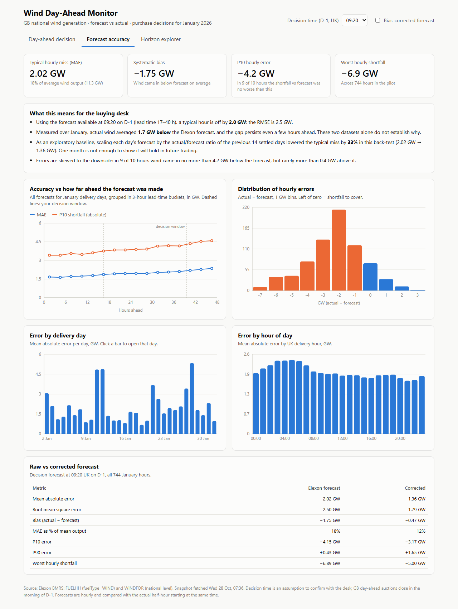

# Wind Day-Ahead Monitor

A web app for a UK utility's day-ahead buying desk. It shows:

1. **The wind forecast the desk actually had at decision time.** For each delivery day, this is the latest Elexon
   forecast published before day-ahead gate closure on D-1, plotted against what was generated, with a historical P10–P90 error range.
2. **How accurate that forecast is.** It measures error by lead time, by day and by hour of day, and shows the error
   distribution. It also offers an exploratory, look-ahead-free bias correction that lowered the typical error by about a third in
   the January back-test.

Scope: GB national **wind** only, using Elexon BMRS `FUELHH` (actuals, `fuelType=WIND`) and `WINDFOR` (forecasts),
for purchase decisions made in **January 2026** (delivery days 2 Jan – 1 Feb 2026).

**Live app:** https://xk7qmw.vercel.app &nbsp;·&nbsp; **Demo video:** `<YOUTUBE_URL>`



---

## Quick start

### Docker (recommended)
```bash
docker compose up --build
# app:      http://localhost:3000   (nginx serves the UI and proxies /api to the backend)
# API docs: http://localhost:8000/docs
```

### Local development
```bash
# backend (Python 3.12)
pip install -r backend/requirements.txt
uvicorn app.main:app --app-dir backend --reload --port 8000

# frontend (Node 20+), in a second terminal. Vite proxies /api to :8000
cd frontend && npm install && npm run dev          # http://localhost:5173
```

### Tests
```bash
pip install pytest httpx
cd backend && python -m pytest -q
```

### Refresh the data snapshot (optional)
```bash
python backend/scripts/fetch_data.py     # re-downloads from Elexon into backend/data/snapshot.json
python backend/scripts/explore.py        # prints the headline numbers used in docs/ANALYSIS.md
```

### Deploy to Vercel
```bash
vercel --prod     # vercel.json builds frontend/ as static and api/index.py as a Python function
```

---

## Repository layout

| Path | What it is |
|---|---|
| `backend/app/data.py` | Loads the snapshot into in-memory indexes; `latest_forecast(target, published_by)` is the no-look-ahead lookup (bisect over publish times). |
| `backend/app/analysis.py` | All domain logic as pure functions: gate-closure timing (UK local time, DST-safe), decision-forecast selection, bias correction, error band, accuracy statistics. |
| `backend/app/main.py` | FastAPI layer: input validation and response caching. Serves JSON only. |
| `backend/data/snapshot.json` | Elexon data for 20 Dec 2025 – 2 Feb 2026 (~2.1k actuals, ~27k forecast rows, ~1 MB). |
| `backend/scripts/fetch_data.py` | Downloads the snapshot from the Elexon stream endpoints. |
| `backend/scripts/explore.py` | Prints the summary statistics used in the analysis write-up. |
| `backend/tests/` | Unit tests (synthetic data, hand-checkable) and API smoke tests (real snapshot). |
| `backend/Dockerfile` | API image: python:3.12-slim + uvicorn on :8000, with a health check. |
| `frontend/src/App.tsx` | Shell: global controls (decision time, bias correction), tabs, delivery-day picker. |
| `frontend/src/components/DayAhead.tsx` | Decision view: KPI tiles plus actual vs decision forecast with P10–P90 band. |
| `frontend/src/components/Accuracy.tsx` | Accuracy view: KPIs, plain-language insights, lead-time/day/hour/distribution charts, raw vs corrected table. |
| `frontend/src/components/Horizon.tsx` | Horizon explorer: forecast published ≥ N hours ahead vs actual (slider 0–48 h). |
| `frontend/src/api.ts` | Typed API client (response types mirror the backend). |
| `frontend/Dockerfile`, `frontend/nginx.conf` | UI image: Node builds the app, then nginx serves it and proxies `/api` to the backend container. |
| `api/index.py`, `vercel.json`, `requirements.txt` | Vercel deployment: static frontend plus one Python serverless function. |
| `docker-compose.yml` | Runs both services: `backend` (:8000) and `frontend` (:3000), which starts once the backend is healthy. |
| `docs/ANALYSIS.md` | Findings and method. |

## API

| Endpoint | Purpose |
|---|---|
| `GET /api/meta` | Delivery days, default decision time, data provenance |
| `GET /api/day?day=2026-01-15&gate=09:20&corrected=false` | Decision forecast, P10/P90 band, half-hourly actuals, daily energy and error |
| `GET /api/accuracy?gate=09:20&corrected=false` | Overall stats plus breakdowns by lead time, day and hour, and an error histogram |
| `GET /api/horizon?day=2026-01-15&hours=24` | Latest forecast published ≥ `hours` before each target hour |

Interactive docs: `/docs` (FastAPI/OpenAPI).

## Key design decisions

- **No look-ahead.** A forecast counts only if `publishTime ≤ gate closure`. The bias correction uses only delivery days
  D-2 and earlier, whose actuals are all published before D-1's gate. The P10–P90 band for a day uses the same past-only
  window (D-2 back to D-15), so later outcomes never shape it. Each rule is covered by a unit test.
- **Honest labels.** The band is an empirical historical error range, not a validated forecast interval, and the
  "indicative low-wind energy" figure sums hourly percentiles, so it is not a calibrated daily P10. The app reports the
  measured bias without attributing a cause, because the two datasets alone cannot establish one.
- **Decision time = 09:20 UK on D-1 by default.** This is an assumption: GB day-ahead auctions close on the morning
  of D-1, and the exact time should be confirmed with the desk. It can be changed in the UI. Forecasts are published
  at fixed times (02:30, 04:30, 07:30, 09:30, 11:30, 15:30, 18:30 and 22:30 UTC), so 09:20 picks the 07:30 run.
- **Time zones.** Delivery days and gate closure are UK local time, and all data is UTC. `zoneinfo` makes
  23- and 25-hour days correct (tested).
- **Resolution mismatch.** Forecasts are hourly and actuals half-hourly. Each forecast is compared with the actual
  half-hour starting at the same time. The chart still shows all half-hourly actuals.
- **Sign convention.** `error = actual − forecast`. A negative error means less wind than forecast: a shortfall the
  desk must buy.
- **Snapshot instead of live calls.** The pilot period is historical, so the data is fixed. Shipping a ~1 MB snapshot
  makes the app fast, deterministic and independent of Elexon uptime. `fetch_data.py` refreshes it. A production
  version would run that script on a schedule and store the data in a database.
- **Lightweight backend.** Pure Python with no pandas or numpy: the data is small (about 30k rows), cold starts on
  Vercel stay fast, and the logic is easy to review. Accuracy reports are memoised per (gate, corrected).

## Use of AI tools

This project was built with help from an AI coding assistant (Claude Code, Anthropic). It was used for scaffolding,
writing code and tests, and drafting documentation. Data exploration results and design choices were reviewed
by the author.
